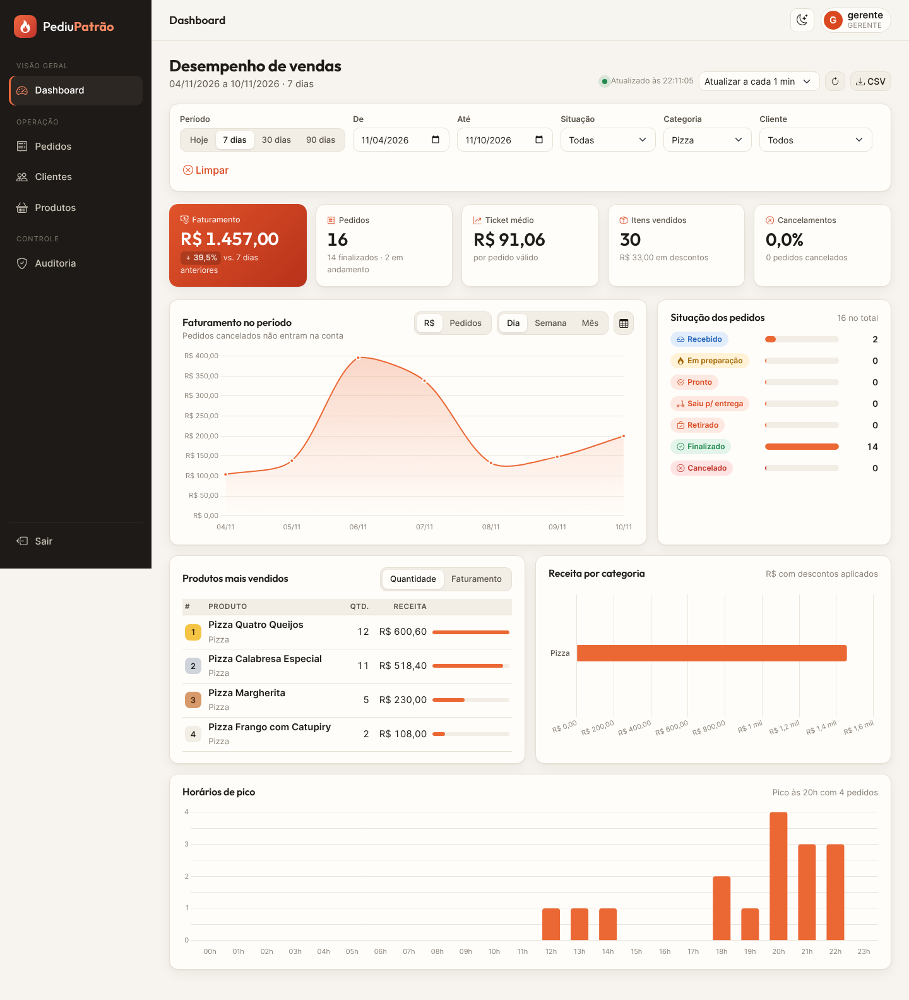

# Evidências de testes

## 1. Testes automatizados

Execução: `./mvnw test` (com `MONGO_URI` definida para incluir os testes de integração).

**Resultado: 37 testes, 0 falhas, 0 erros — BUILD SUCCESS.** Saída completa: [`evidencias/testes-saida.txt`](evidencias/testes-saida.txt)

```
Tests run: 7,  Failures: 0 -- PedidoTest                 (regras do pedido)
Tests run: 4,  Failures: 0 -- DashboardIntegracaoTest    (API + MongoDB real)
Tests run: 12, Failures: 0 -- DashboardCalculadoraTest   (cálculos do dashboard)
Tests run: 7,  Failures: 0 -- DashboardFiltroTest        (validação dos filtros)
Tests run: 7,  Failures: 0 -- DashboardControllerTest    (HTTP, permissões, erros)
Tests run: 37, Failures: 0, Errors: 0, Skipped: 0
BUILD SUCCESS
```

### 1.1 Unidade — `DashboardCalculadoraTest` (regras de cálculo, sem banco)

Massa de teste: 4 pedidos — R$ 110 (finalizado), R$ 60 com 10% de desconto (finalizado),
R$ 30 (em preparação) e R$ 250 (cancelado).

| Teste | Requisito | Verifica |
|---|---|---|
| `resumoGeral` | RF01 | Faturamento R$ 194 (cancelado fora), ticket R$ 64,67, taxa de cancelamento 25%, descontos R$ 6, 7 itens, variação +100% |
| `resumoVazio` | RF01/RF07 | Sem pedidos: tudo zero, sem divisão por zero, variação nula |
| `vendasPorDia` | RF02 | Série diária com o dia sem venda preenchido com zero |
| `vendasPorMes` | RF02 | Agrupamento mensal |
| `vendasPorCategoria` | RF02 | Desconto proporcional por item (Pizza R$ 154, Bebida R$ 40) |
| `vendasPorHora` | RF02 | 24 posições; pedido cancelado não conta |
| `situacao` | RF03 | Todos os 7 status, inclusive zerados, com percentual |
| `ranking` | RF04 | Ordenação por quantidade e por faturamento, limite |
| `filtroCategoria` | RF05 | Só itens da categoria entram |
| `tratamentoDeDados` | RF07 | Pedido sem data descartado; produto sem categoria vira "Outros" |
| `agrupamentoInvalido`, `variacao` | RF07 | Validação e cálculo de variação negativa |

### 1.2 Unidade — `DashboardFiltroTest`

Período padrão de 30 dias, status sem diferenciar maiúsculas, data inválida, período invertido,
período maior que 366 dias, status inexistente e cálculo do período anterior.

### 1.3 Controller — `DashboardControllerTest` (`@WebMvcTest` + Spring Security)

| Cenário | Esperado |
|---|---|
| GERENTE consulta `/resumo` | 200 + JSON com os campos |
| ADMIN consulta `/produtos/top` | 200 + ranking |
| ATENDENTE consulta o dashboard | **403** |
| Sem login | **401** (não redireciona para a tela de login) |
| `dataInicio=01/11/2026` | **400** com `mensagem` e `caminho` |
| Período invertido | **400** |
| `limite=dez` | **400** `"Parâmetro 'limite' com valor inválido: dez"` |

### 1.4 Integração — `DashboardIntegracaoTest` (`@SpringBootTest` + MongoDB real)

Banco separado `pizzaria_test`, limpo antes de cada teste, com pedidos conhecidos (um deles fora do período).

| Cenário | Esperado |
|---|---|
| Painel dos últimos 7 dias (HTTP Basic `gerente`) | faturamento 140, 3 pedidos, 1 cancelado, 7 pontos na série, 24 horas |
| Filtro `status=FINALIZADO` + `categoria=Pizza` | faturamento 100, 1 pedido |
| `/filtros` | categorias e clientes lidos do banco |
| Senha errada | 401 |

### 1.5 Regras do pedido — `PedidoTest` (já existente)

Cálculo de total, desconto até 20%, fluxo de status, bloqueio após expedição e após cancelamento,
justificativa obrigatória.

## 2. Testes manuais da API (curl)

Requisições reais contra a aplicação rodando com MongoDB — saída completa em
[`evidencias/api-requisicoes.txt`](evidencias/api-requisicoes.txt).

| # | Requisição | Usuário | Resultado |
|---|---|---|---|
| 1 | `GET /resumo?dataInicio=2026-11-01&dataFim=2026-11-10` | gerente | 200 ✅ |
| 2 | `GET /vendas?...&agrupamento=dia` | gerente | 200 ✅ (7 dias) |
| 3 | `GET /status` | gerente | 200 ✅ |
| 4 | `GET /produtos/top?limite=3&ordenarPor=faturamento` | admin | 200 ✅ |
| 5 | `GET /categorias?status=FINALIZADO` | admin | 200 ✅ |
| 6 | `GET /filtros` | gerente | 200 ✅ |
| 7 | `GET /vendas?dataInicio=2026-11-10&dataFim=2026-11-01` | gerente | 400 ✅ período invertido |
| 8 | `GET /resumo?status=ENTREGUE` | gerente | 400 ✅ status inválido |
| 9 | `GET /produtos/top?limite=99` | gerente | 400 ✅ limite fora da faixa |
| 10 | `GET /resumo` | atendente | 403 ✅ |
| 11 | `GET /resumo` | senha errada | 401 ✅ |

Desempenho: o painel completo de 90 dias (~440 pedidos) respondeu em ~0,11 s (3 medições locais).

## 3. Testes de interface (navegador)

Roteiro executado com Playwright (Chromium) logando com os usuários reais. Nenhum erro de JavaScript
no console. Capturas em `docs/evidencias/`:

| Arquivo | O que mostra |
|---|---|
| `00-login.png` | Tela de login |
| `01-dashboard-claro.png` | Dashboard completo (30 dias) — RF01 a RF04 |
| `02-dashboard-filtro-7dias-pizza.png` | Filtros aplicados: 7 dias + categoria Pizza — RF05 |
| `03-dashboard-escuro.png` | Modo escuro |
| `04-pedidos.png` | Lista de pedidos com filtros por situação e ações permitidas |
| `05-modal-desconto.png` | Modal de desconto com prévia do novo total |
| `06-modal-cancelamento.png` | Modal de cancelamento com justificativa |
| `07-detalhe-pedido.png` | Detalhes do pedido com linha do tempo |
| `08-novo-pedido.png` | Novo pedido (atendente) com total ao vivo |
| `09-auditoria.png` | Auditoria registrando desconto, cancelamento, criação e mudança de status feitos no roteiro |
| `10-dashboard-mobile.png` | Dashboard em celular (390 px) sem rolagem horizontal |

Verificações adicionais do roteiro:
- ATENDENTE acessando `/dashboard` → **403** (bloqueado).
- Após o gerente aplicar desconto e cancelar um pedido, os registros aparecem na auditoria com valores antes/depois.


